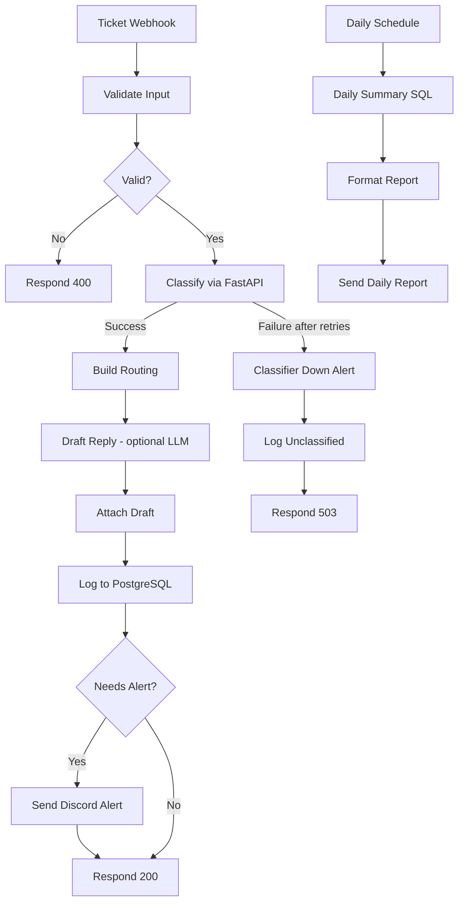
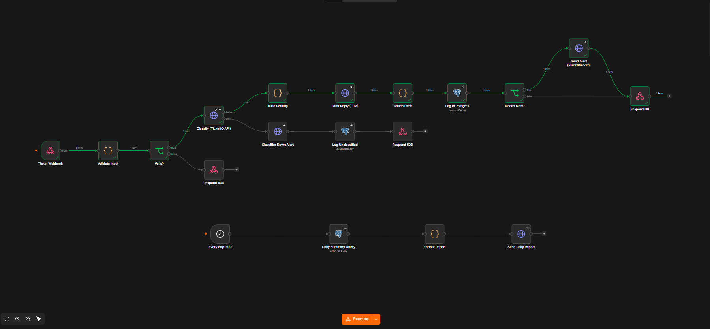
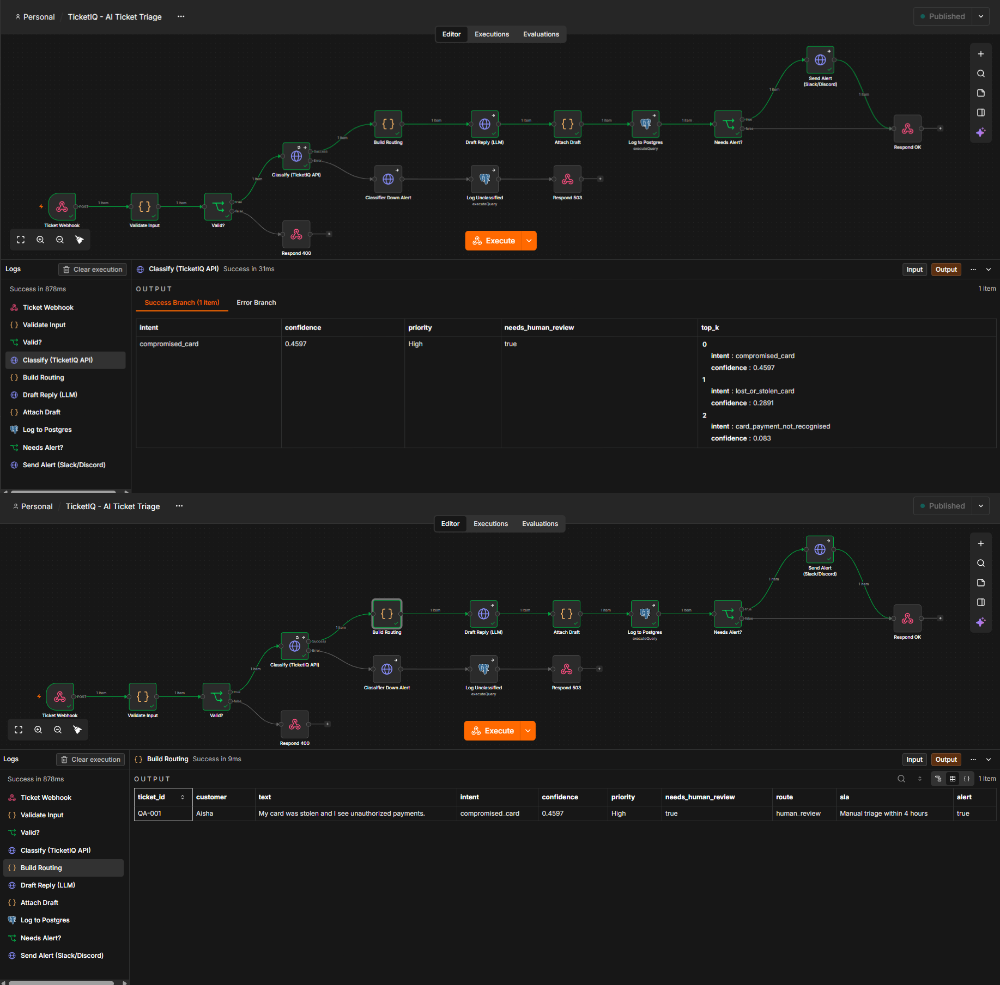
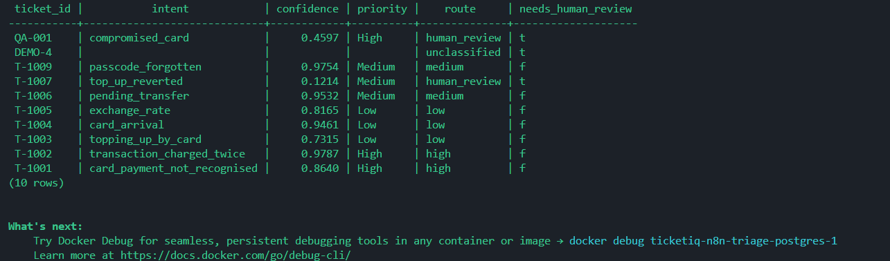
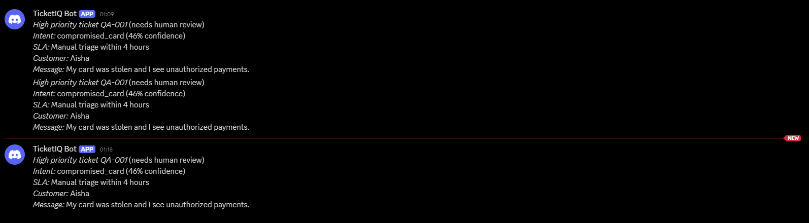
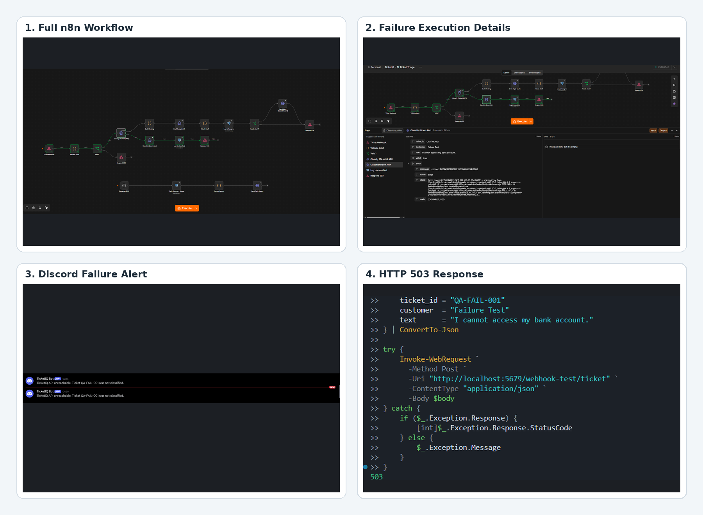

<div align="center">

# 🎫 TicketIQ - AI Ticket Triage Automation

**Intelligent support-ticket classification, priority routing, and operational alerts — orchestrated with n8n.**

<p>
  
  
  
  
  
</p>

<p>
  <a href="#-overview">Overview</a> ·
  <a href="#-workflow">Workflow</a> ·
  <a href="#-screenshots">Screenshots</a> ·
  <a href="#-quick-start">Quick start</a> ·
  <a href="#-testing">Testing</a>
</p>

</div>

---

## 🚀 Overview

**TicketIQ** is an AI-assisted support-ticket triage workflow built around **n8n**, a **DistilBERT-based classification API served with FastAPI**, **PostgreSQL**, and **Discord webhook notifications**.

A ticket enters through a webhook, is validated, classified, and routed based on priority and model confidence. The workflow logs ticket details to PostgreSQL, sends alerts for tickets that need attention, and includes a fallback path for classifier failures.

> **Design principle:** low-confidence predictions should be reviewed by a human instead of being treated as certain.

## ✨ Key capabilities

- **Webhook intake and validation** — accepts incoming tickets and checks required input before processing.
- **ML-powered intent classification** — sends ticket text to a FastAPI `/predict` endpoint backed by a DistilBERT classifier.
- **Priority and SLA routing** — builds a routing decision from the classifier result, including a human-review path for uncertain predictions.
- **Discord notifications** — sends ticket alerts to a configured Discord webhook.
- **PostgreSQL persistence** — stores ticket metadata and classification/routing results.
- **Duplicate-safe database writes** — uses an upsert keyed by `ticket_id`, so repeated submissions update the existing record rather than creating another row.
- **Failure path** — retries the classifier request and, if the classifier remains unavailable, triggers a failure alert, logs the ticket as unclassified, and returns an HTTP `503` response.
- **Daily summary flow** — includes a scheduled SQL summary and report-delivery path in the workflow.

## 🧰 Technology stack

| Component | Purpose |
|---|---|
| **n8n** | Workflow orchestration, branching, retries, and scheduled automation |
| **DistilBERT** | Support-ticket intent classification |
| **FastAPI** | Serves the classifier through HTTP endpoints |
| **PostgreSQL 16** | Ticket records, upserts, and summary queries |
| **Discord Webhook** | Operational ticket and failure notifications |
| **Docker Compose** | Runs the n8n and PostgreSQL services |
| **Python / PowerShell** | Test-ticket script and local validation |

## 🔄 Workflow



### Ticket lifecycle

1. **Receive** — a ticket is posted to the webhook.
2. **Validate** — required fields are checked; invalid input follows the `400` path.
3. **Classify** — the ticket text is sent to the FastAPI classifier.
4. **Route** — intent, confidence, priority, SLA, and human-review status are assembled.
5. **Persist** — ticket data is stored in PostgreSQL using `ticket_id` as the conflict key.
6. **Notify** — relevant tickets are sent to Discord.
7. **Recover** — classifier failure follows a separate alert, logging, and `503` response path.

## 🖼️ Screenshots

The screenshots below are stored in the repository's `screenshots/` folder.

### 1. End-to-end workflow



### 2. Successful workflow execution



### 3. FastAPI classifier response


### 4. PostgreSQL ticket records



### 5. Discord ticket alerts



### 6. Failure-handling evidence



> If your screenshot filenames differ, update the corresponding image paths above to match the files in `screenshots/`.

## 🗂️ Repository structure

```text
ticketiq-n8n-triage/
├── screenshots/
│   ├── discord.png
│   ├── fast_api.png
│   ├── node.png
│   ├── PostgreSQL.png
│   ├── ticketiq-failure-handling-evidence.png
│   ├── ticketiq-fastapi-classifier-output.png
│   └── workflow.png
├── scripts/
│   └── send_test_tickets.py
├── sql/
│   └── init.sql
├── workflows/
│   └── ticket_triage.json
├── .env.example
├── .gitignore
├── docker-compose.yml
└── README.md
```

## ⚙️ Quick start

### Prerequisites

- Docker Desktop with Docker Compose
- Python 3.10+ for the local test script and classifier service
- The classifier model and its required Python dependencies
- A Discord webhook URL (if you want to receive alerts)

### 1. Clone the repository

```bash
git clone https://github.com/<YOUR_GITHUB_USERNAME>/ticketiq-n8n-ai-ticket-triage.git
cd ticketiq-n8n-ai-ticket-triage
```

Replace `<YOUR_GITHUB_USERNAME>` with your GitHub username.

### 2. Configure environment variables

Copy the example environment file and fill in the required local values:

**PowerShell**
```powershell
Copy-Item .env.example .env
```

**macOS / Linux**
```bash
cp .env.example .env
```

Add your own credentials and configuration locally. **Never commit `.env`, API keys, database passwords, or webhook secrets.**

### 3. Start n8n and PostgreSQL

```bash
docker compose up -d
docker compose ps
```

Open the n8n URL configured by your Compose file. In the current local setup, n8n was exposed at:

```text
http://localhost:5679
```

PostgreSQL was exposed at port `5433` in the local setup. Your ports may differ if you change `docker-compose.yml`.

### 4. Start the FastAPI classifier

Start the classifier from the classifier project's own directory using that project's documented environment and startup command. Confirm the service is healthy:

```powershell
Invoke-RestMethod http://localhost:8000/health
```

The local API used by this workflow exposes:

- `GET /health` — service/model health
- `POST /predict` — ticket-intent prediction

When n8n runs in Docker and the classifier runs on the host machine, the n8n HTTP Request node typically needs to reach the host through `host.docker.internal`, for example:

```text
http://host.docker.internal:8000/predict
```

Check the URL and port in your own workflow before running it.

### 5. Import and configure the workflow

1. Open n8n.
2. Import `workflows/ticket_triage.json` if the workflow is not already present.
3. Verify the classifier URL, PostgreSQL credentials, Discord webhook configuration, and any optional LLM settings.
4. Save and publish/activate the workflow as required for your chosen webhook mode.

**Test webhook note:** n8n's test webhook is temporary and usually needs **Execute workflow** / **Listen for Test Event** before sending a test request. For repeated or production-style requests, use the production webhook URL after publishing/activating the workflow.

## 🧪 Testing

### Send one test ticket

With the workflow in test-listening mode, run:

```powershell
$body = @{
    ticket_id = "DEMO-1"
    customer  = "Aisha"
    text      = "My card was stolen and I see payments I did not make."
} | ConvertTo-Json

Invoke-RestMethod `
  -Method Post `
  -Uri "http://localhost:5679/webhook-test/ticket" `
  -ContentType "application/json" `
  -Body $body
```

Adjust the URL if your n8n port or webhook path is different.

### Run the included test-ticket script

```powershell
python scripts/send_test_tickets.py --test --host http://localhost:5679
```

The test mode requires the n8n test webhook to be listening. A `404` response saying the webhook is not registered usually means the test listener was not active or the URL/path does not match.

### Check the stored ticket

```powershell
docker exec ticketiq-n8n-triage-postgres-1 psql -U ticketiq -d ticketiq -c "SELECT ticket_id, intent, confidence, priority, route, needs_human_review FROM tickets ORDER BY id DESC LIMIT 10;"
```

The container name and database settings may differ on another machine; use the values in your own Compose configuration.

### Verify duplicate-safe writes

Submit the same `ticket_id` twice, then run:

```powershell
docker exec ticketiq-n8n-triage-postgres-1 psql -U ticketiq -d ticketiq -c "SELECT ticket_id, COUNT(*) AS record_count FROM tickets WHERE ticket_id = 'QA-001' GROUP BY ticket_id;"
```

For the tested `QA-001` case, the query returned one row for that ticket ID, consistent with the workflow's `ON CONFLICT (ticket_id) DO UPDATE` upsert.

### Verify failure handling

1. Temporarily stop the FastAPI classifier process (do not stop n8n or PostgreSQL).
2. Start a fresh n8n test execution and submit a test ticket.
3. Confirm the classifier error/retry path, failure notification, unclassified database logging, and `503` response.
4. Restart the classifier and confirm `GET /health` returns a healthy response.

Only describe the failure path as verified if all relevant outcomes are visible in the execution and logs.

## 🔐 Security notes

- Keep `.env` and all real credentials out of Git.
- Use `.env.example` only for variable names and safe placeholder values.
- Review exported n8n workflow JSON before publishing; remove secrets and sensitive webhook URLs.
- Do not use real customer or payment data in public demos. Use synthetic tickets.
- Treat low-confidence predictions as a signal for human review, not as a definitive decision.

## 🛣️ Possible next improvements

- Add automated tests for valid, invalid, duplicate, and classifier-unavailable requests.
- Add monitoring for classification confidence and API latency.
- Add a dead-letter/replay mechanism for tickets that cannot be classified.
- Add structured logs and alert-deduplication to prevent repeated notifications.
- Validate the scheduled summary report end-to-end in the target deployment.

## 👤 Author

**Md. Sakender Saikot**

[GitHub](https://github.com/Saikot313)

---

<div align="center">

**TicketIQ — turn incoming support tickets into actionable, traceable workflows.**

<sub>Built as a practical automation and ML integration portfolio project.</sub>

</div>
